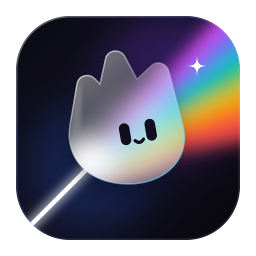
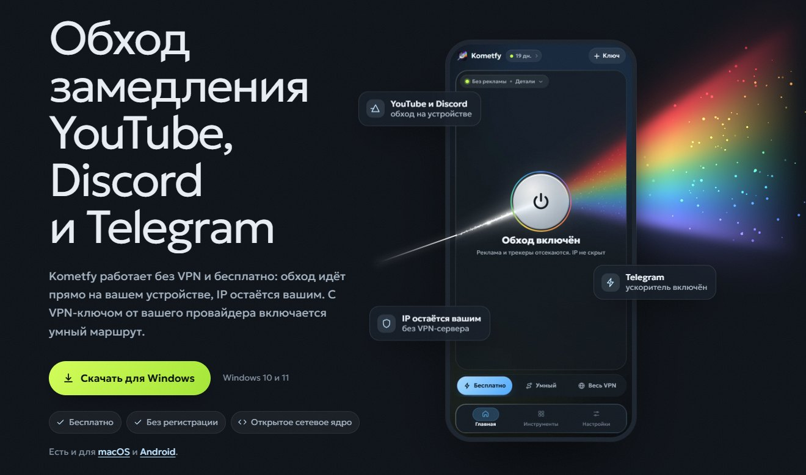
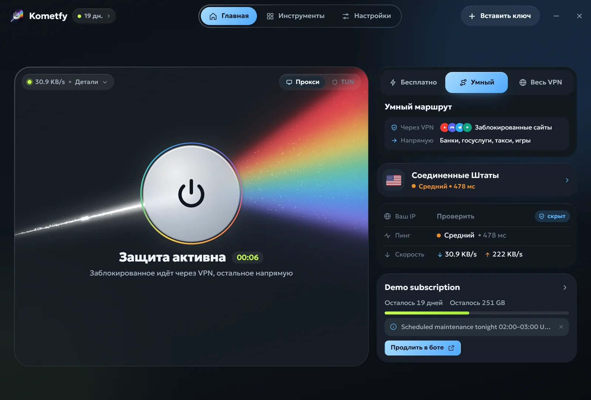
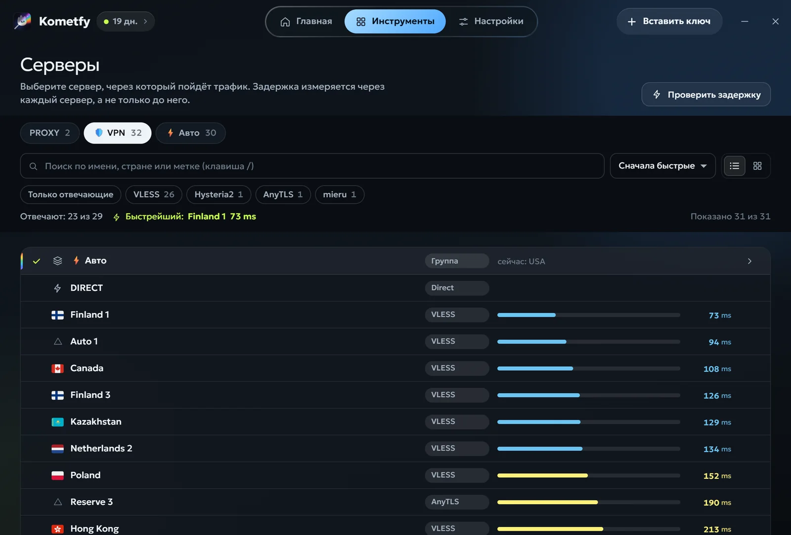
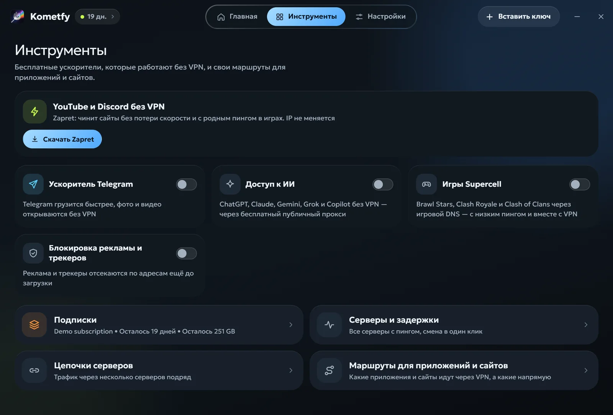
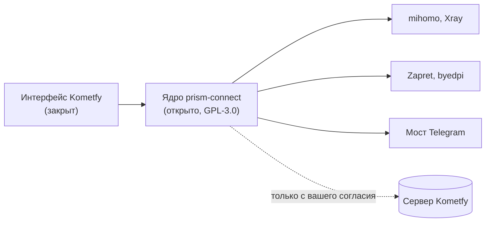

<div align="center">



# Kometfy

**Обход замедления YouTube, Discord и Telegram. Бесплатно, без регистрации, прямо на устройстве.**

[](https://github.com/TABURELTER/Kometfy/releases/latest)
[](LICENSE)
[](https://kometfy.com/#download)

[Скачать](https://kometfy.com/#download) · [Сайт](https://kometfy.com) · [Канал в Telegram](https://t.me/Kometfy) · [Релизы](https://github.com/TABURELTER/Kometfy/releases) · [English](#english)

<br>



</div>

## Скачать

| | Требования | |
|---|---|---|
| **Windows** | Windows 10 и 11, 64 бит | [Установщик](https://kometfy.com/download/windows) |
| **macOS** | macOS 13 и новее, Apple Silicon | [Образ DMG](https://kometfy.com/download/macos) |
| **Android** | Android 8 и новее | [Файл APK](https://kometfy.com/download/android) |

Все версии и что в них изменилось: [релизы](https://github.com/TABURELTER/Kometfy/releases). Новые версии приложение
находит само и ставит только файл с подписью проекта.

## Три режима

| | Нужно | Что происходит |
|---|---|---|
| **Бесплатно** | ничего | Обход замедления YouTube и Discord идёт на вашем устройстве: Zapret на Windows, byedpi на Android и macOS. Ускоритель Telegram, блокировка рекламы. IP остаётся вашим. |
| **Умный** | ключ VPN от вашего провайдера | Заблокированное идёт через VPN, банки, госуслуги и остальные сайты напрямую. |
| **Весь VPN** | ключ VPN от вашего провайдера | Весь трафик через сервер. |

Kometfy не продаёт ни серверов, ни подписок. Он понимает ссылки и ключи `vless://`, `vmess://`, `trojan://`, `ss://`,
`hysteria2://`, `tuic://`, `anytls://`, конфиги WireGuard и AmneziaWG, подписки Clash и показывает остаток трафика и срок
подписки.

<table>
  <tr>
    <td width="33%"></td>
    <td width="33%"></td>
    <td width="33%"></td>
  </tr>
</table>

## Что здесь открыто

Kometfy состоит из закрытого интерфейса и открытого сетевого ядра. В этом репозитории ядро, то есть всё, что
приложение делает с вашим трафиком. Его можно прочитать и собрать самому.



| Что | Где |
|---|---|
| Ссылки, ключи и подписки | [`links.rs`](crates/prism-connect/src/links.rs), [`subscription.rs`](crates/prism-connect/src/subscription.rs), [`profiles.rs`](crates/prism-connect/src/profiles.rs) |
| Конфиг и запуск [mihomo](https://github.com/MetaCubeX/mihomo) и Xray, проверка скачанного ядра по SHA-256 | [`config.rs`](crates/prism-connect/src/config.rs), [`mihomo.rs`](crates/prism-connect/src/mihomo.rs), [`coredl.rs`](crates/prism-connect/src/coredl.rs) |
| TUN и системный прокси, возврат настроек после сбоя | [`sysproxy.rs`](crates/prism-connect/src/sysproxy.rs), [`proxy_recovery_model.rs`](crates/prism-connect/src/proxy_recovery_model.rs) |
| Обход DPI без VPN и подбор стратегии | [`zapret.rs`](crates/prism-connect/src/zapret.rs), [`byedpi.rs`](crates/prism-connect/src/byedpi.rs), [`dpi.rs`](crates/prism-connect/src/dpi.rs), [`third_party/byedpi`](third_party/byedpi) |
| Ускоритель Telegram: локальный MTProto-мост к веб-шлюзам Telegram | [`tgbridge.rs`](crates/prism-connect/src/tgbridge.rs) |
| Сетевой помощник macOS, который доверяет только приложению с подписью Kometfy | [`app/src-tauri/macos`](app/src-tauri/macos) |
| Всё, что уходит на сервер Kometfy, и при каком согласии | [`remote.rs`](crates/prism-connect/src/remote.rs), [`probes.rs`](crates/prism-connect/src/probes.rs), [`metrics.rs`](crates/prism-connect/src/metrics.rs) |

## Конфиденциальность

- До первого экрана с вопросами приложение ничего не отправляет. Каждый вид данных включается отдельно, и всё это
  можно выключить в настройках.
- Kometfy не отправляет и не хранит ваш IP-адрес, серверы, открытые сайты, ключи и ссылки на подписки.
- Адрес сервера Kometfy ядру передаёт сборка приложения при запуске ([`builtin.rs`](crates/prism-connect/src/builtin.rs)).
  В открытом ядре его нет, поэтому ядро, собранное отсюда, ни с каким сервером не связывается.

Что именно отправляется и зачем: [docs/PRIVACY.md](docs/PRIVACY.md). Уязвимость: [SECURITY.md](SECURITY.md).

## Проверить самому

Нужен Rust stable. Ядро собирается для Windows, macOS и Android (`aarch64-linux-android`).

```sh
git clone https://github.com/TABURELTER/Kometfy
cd Kometfy
cargo test -p prism-connect --lib
```

Каждый установщик в релизах подписан ключом проекта, им же приложение проверяет обновления. Файл `.sig` рядом с
установщиком — подпись [minisign](https://jedisct1.github.io/minisign/) в base64:

```sh
base64 -d Kometfy_1.0.0_x64-setup.exe.sig > setup.minisig
minisign -Vm Kometfy_1.0.0_x64-setup.exe -x setup.minisig -P RWRPHHvqa8knM07dYob66FrtMB9xtznFHRKoGvO/59QL2AXA0qj3HDeD
```

## Связь

- Новости и новые версии: канал [t.me/Kometfy](https://t.me/Kometfy).
- Написать автору: [@TABURELTER](https://t.me/TABURELTER) в Telegram.
- Ошибки и идеи: [Issues](https://github.com/TABURELTER/Kometfy/issues/new/choose). Уязвимости: закрытым сообщением,
  как в [SECURITY.md](SECURITY.md).

## Лицензия

Ядро: [GPL-3.0-only](LICENSE). Сторонние компоненты и их лицензии: [NOTICE.md](NOTICE.md). Как предложить изменение:
[CONTRIBUTING.md](CONTRIBUTING.md). Интерфейс приложения закрыт.

---

## English

**Kometfy gets YouTube, Discord and Telegram past throttling, free, with no sign-up, right on your device.**

Kometfy is an app for Windows 10/11, macOS 13+ on Apple Silicon and Android 8+ ([download](https://kometfy.com/#download)).
It has three modes:

- **Free** needs nothing. DPI bypass runs on the device (Zapret on Windows, byedpi on Android and macOS), with a
  Telegram accelerator and ad blocking. Your IP stays yours.
- **Smart** needs a VPN key from your provider. Blocked services go through the VPN and everything else goes direct.
- **Full VPN** sends all traffic through the server.

Kometfy sells no servers or subscriptions.

This repository holds the app's network core, `crates/prism-connect`, under GPL-3.0: everything the app does with your
traffic. The core covers:

- share links and subscriptions;
- the mihomo and Xray cores, checked against their published SHA-256;
- TUN and the system proxy;
- DPI bypass;
- the Telegram bridge;
- the macOS network helper;
- in `remote.rs` and `probes.rs`, everything the app sends to Kometfy's server and under which consent.

Nothing is sent before the welcome screen asks, and every kind of data has its own switch. The server's address comes
from the app build at start (`builtin.rs`), so a core built from here talks to no server.

Build and test with Rust stable: `cargo test -p prism-connect --lib`. Every installer is signed with the project's
minisign key (above), the same key the app checks updates with.

News: [t.me/Kometfy](https://t.me/Kometfy). The author: [@TABURELTER](https://t.me/TABURELTER) on Telegram.

License: [GPL-3.0-only](LICENSE). Third-party notices are in [NOTICE.md](NOTICE.md), contributions go as in
[CONTRIBUTING.md](CONTRIBUTING.md). The app's interface is closed.
